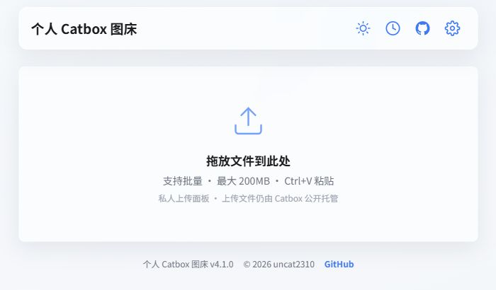
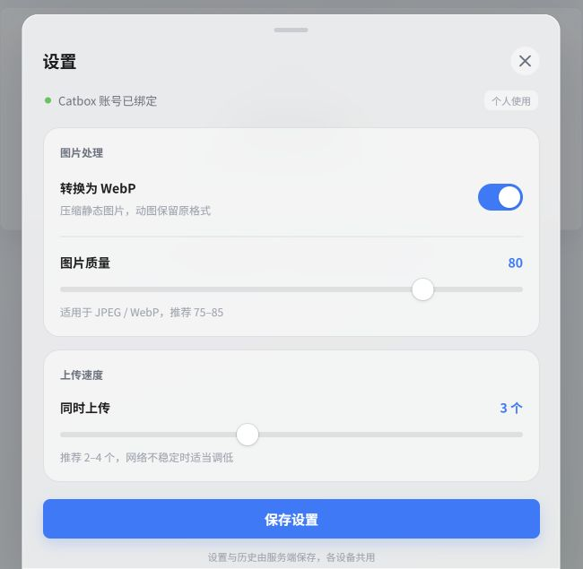
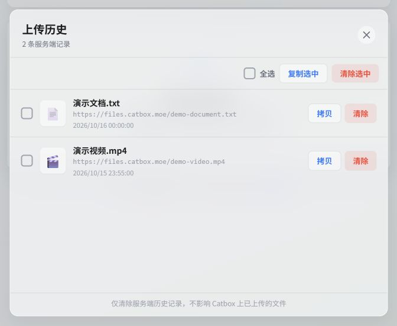

# 个人 Catbox 图床

[](https://github.com/uncat2310/catbox-imagehost/actions/workflows/docker-publish.yml)

一个部署后自己使用的 Catbox 上传面板。部署时绑定自己的 Catbox Userhash，使用独立密码访问；设置和上传历史由服务器统一保存，换设备打开即可继续使用。

当前版本：**v4.1.0** · Python 3.11+ · Docker 支持 amd64 / arm64



> **面板私有，文件公开。** 访问面板需要密码，但上传成功后的文件由 Catbox 公开托管，任何持有文件直链的人仍可访问。请勿上传私密文件。

## 功能

- 拖放、选择文件或 `Ctrl+V` 粘贴上传，支持批量任务与取消上传。
- 静态图片可压缩或转换为 WebP，支持调整质量，动图保留原格式。
- 上传历史保存在服务器，支持复制链接、批量选择和清除记录，最多保留 500 条。
- 图片处理与上传并发设置保存在服务器，其他设备刷新或重新打开后读取最新设置。
- 简洁的设置面板、浅色与深色主题，适配电脑和手机。
- Catbox 凭证仅由服务端使用，浏览器无需填写或保存 Userhash。

本项目面向单人自用，不提供多用户注册、访客上传或客户端切换 Catbox 账号。

## 界面预览

### 设置

仅保留账号绑定状态、图片处理和上传速度。保存后由服务器统一管理，无需手动导出、恢复或在设备间传递配置。



### 上传历史

清除操作只移除面板中的历史记录。管理或删除 Catbox 上的实际文件，请前往 Catbox 后台。



以上截图使用演示数据，不包含真实凭证或个人上传记录；演示文件链接不用于下载。

## 快速部署

推荐使用 Docker Compose 和 GitHub Actions 已构建的镜像。

### 1. 准备配置

```sh
git clone https://github.com/uncat2310/catbox-imagehost.git
cd catbox-imagehost
cp .env.example .env
chmod 600 .env
```

在服务器上编辑 `.env`，替换以下两个必填项：

| 变量 | 说明 |
| --- | --- |
| `CATBOX_USERHASH` | 自己的 Catbox Userhash，用于服务端上传认证 |
| `APP_PASSWORD` | 面板访问密码，至少 8 位，建议使用随机生成的长密码 |

真实凭证只放在服务器的环境配置中，不要提交到 Git、写入镜像构建参数或放进截图。能管理宿主机或容器的人可以读取运行环境中的凭证。

### 2. 启动

```sh
docker compose pull
docker compose up -d --no-build
```

在服务器本机打开 `http://localhost:7800`，在浏览器的登录提示中输入：

- 用户名：`admin`
- 密码：`.env` 中设置的 `APP_PASSWORD`

默认端口仅绑定 `127.0.0.1`。远程访问请继续配置 HTTPS 入口。

仓库中的 Compose 将数据保存在宿主机的 `./catbox-imagehost/`，映射到容器的 `/app/config`。更新或重建容器时保留此目录。

如需从本地源码构建，可改用 `docker compose up -d --build`。

### 3. 配置 HTTPS 入口

可通过 Caddy 或 Cloudflare Tunnel 将域名转发到 `127.0.0.1:7800`。Caddy 示例：

```caddy
catbox.example.com {
    request_body {
        max_size 201MB
    }
    reverse_proxy 127.0.0.1:7800
}
```

反向代理需要保留 `Host`、`Origin` 和 `Authorization`，并禁止缓存页面和 API。公网入口应使用 HTTPS，避免直接暴露应用端口；Cloudflare 等入口可能有更低的请求大小限制，以实际入口为准。

页面、静态资源和管理 API 都需要认证，仅 `/api/health` 公开用于健康检查。服务拒绝跨站修改请求，不开放 CORS。

## 日常使用与限制

| 项目 | 当前行为 |
| --- | --- |
| 账号 | 部署时绑定；更换账号需修改服务器的 `CATBOX_USERHASH` 并重启 |
| 设置同步 | 保存到服务器；其他设备刷新或重新打开后读取，不提供实时推送 |
| 历史记录 | 服务端最多保存 500 条；清除记录不会删除 Catbox 文件 |
| 上传大小 | 默认单文件及单次请求的文件总大小均为 200 MiB，单次最多 20 个文件 |
| 图片处理 | 图片最多 2000 万像素，20 MiB 以内的静态图片可转码，动图保留原文件 |
| 上传并发 | 可设置 1–6 个；网络不稳定时适当调低 |

超出转码大小的图片保留原文件并提示；超出像素上限则拒绝处理。关闭 WebP 时保留原格式，同格式压缩后更大的文件会保留原文件。处理失败后的回退会显示提示。

取消上传会停止浏览器当前请求和后续任务；已经被 Catbox 接收的文件可能仍然存在。

浏览器会缓存当前 HTTP Basic 登录凭证。公共设备建议使用隐私窗口，用完后关闭；修改 `APP_PASSWORD` 并重启服务可使旧凭证失效。

## 更新与备份

Actions **只构建并发布镜像，不自动更新服务器**。按需更新前，先备份数据与配置，再执行：

```sh
git pull --ff-only
docker compose pull
docker compose up -d --no-build
docker compose ps
```

`latest` 跟随主分支发布。需要固定版本时，将 Compose 的 `image` 改为通过检查的提交 SHA 标签或不可变镜像 digest，然后再拉取与启动。更新后确认容器健康，并实际登录、读取历史和上传文件。

设置和历史存储在数据目录下的 `settings.db`。备份时停止服务后复制整个数据目录，或使用 SQLite backup API 创建一致性快照；`.env` 单独备份并限制权限。恢复时停止服务，恢复数据目录和对应环境配置，再重新启动。

v4.1 已移除浏览器备份、恢复和加密备份功能，以及 `/api/export`、`/api/import` 接口。设备间同步由服务器完成，灾难恢复依靠服务器备份。

### 从旧版迁移

- 首次启动会读取数据目录中原来的 `settings.json`，迁移合法设置与 Catbox 历史，并过滤重复或不安全的历史地址；原文件不被修改。
- 旧 JSON 中的 Userhash 不作为新版运行凭证，必须显式配置 `CATBOX_USERHASH`。迁移后将含凭证的旧文件移到受保护的备份位置。
- 打开新版页面时，会清理浏览器中旧的 `catbox-userhash` 本地存储。
- 升级前备份旧源码版本、数据和服务配置；回退时恢复匹配的数据与配置，并留意升级后新增的记录。

## 源码运行

需要 Python 3.11+。Linux 示例：

```sh
python3 -m venv venv
venv/bin/pip install -r backend/requirements.lock
cp .env.example .env
chmod 600 .env
# 编辑 .env，配置两个必填项
./run.sh
```

Windows 在创建虚拟环境并安装同一锁文件后运行：

```powershell
venv\Scripts\python -m uvicorn backend.main:app --host 127.0.0.1 --port 7800 --workers 1 --env-file .env
```

源码运行的可选环境变量：

| 变量 | 默认值 | 说明 |
| --- | --- | --- |
| `MAX_FILE_SIZE_MB` | `200` | 单文件上限，范围 1–200 MiB |
| `CONFIG_DIR` | 项目下的 `config` | 设置与历史的数据目录 |
| `PORT` | `7800` | 启动脚本使用的监听端口 |
| `HOST` | `127.0.0.1` | 启动脚本使用的监听地址 |

Compose 使用固定的容器端口和数据映射；如需调整这些可选参数，请相应修改 Compose 文件，单独修改 `.env` 不会自动传入所有可选项。

保持 **1 个 worker、1 个实例**：上传并发限制在单进程内执行，达到上限返回 503，不无限排队。批量请求中的文件顺序上传，前端可并发发送单文件请求。多进程或多副本部署需要另行实现共享队列和统一配额。

## 开发与自动构建

```sh
venv/bin/pip install -r requirements-dev.txt
venv/bin/python -m unittest discover -s tests -v
node --check frontend/app.js
venv/bin/python scripts/check_secrets.py --history
```

测试使用临时目录和模拟 Catbox，不需要实际凭证或真实上传。依赖锁定在 `backend/requirements.lock`；更新依赖时，同时更新直接依赖清单与锁文件，并执行测试和依赖审计。

[GitHub Actions](https://github.com/uncat2310/catbox-imagehost/actions/workflows/docker-publish.yml) 执行历史凭证检查、回归测试、依赖审计，以及实际容器启动、认证和重启持久化验证，通过后构建 amd64 / arm64 镜像。

- 主分支发布 GHCR 的 `latest`、`main` 和完整提交 SHA 标签。
- 版本标签触发对应版本镜像发布。
- PR 执行检查与构建，不登录镜像仓库、不推送镜像。
- 工作流不连接 VPS，也不需要 Catbox Userhash 或面板密码。

镜像地址：`ghcr.io/uncat2310/catbox-imagehost`
